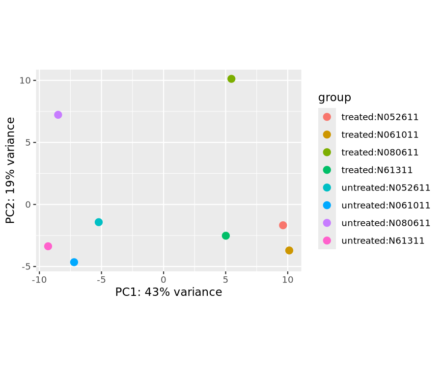
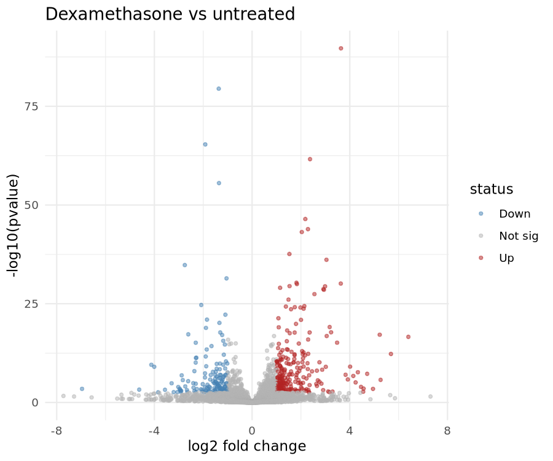
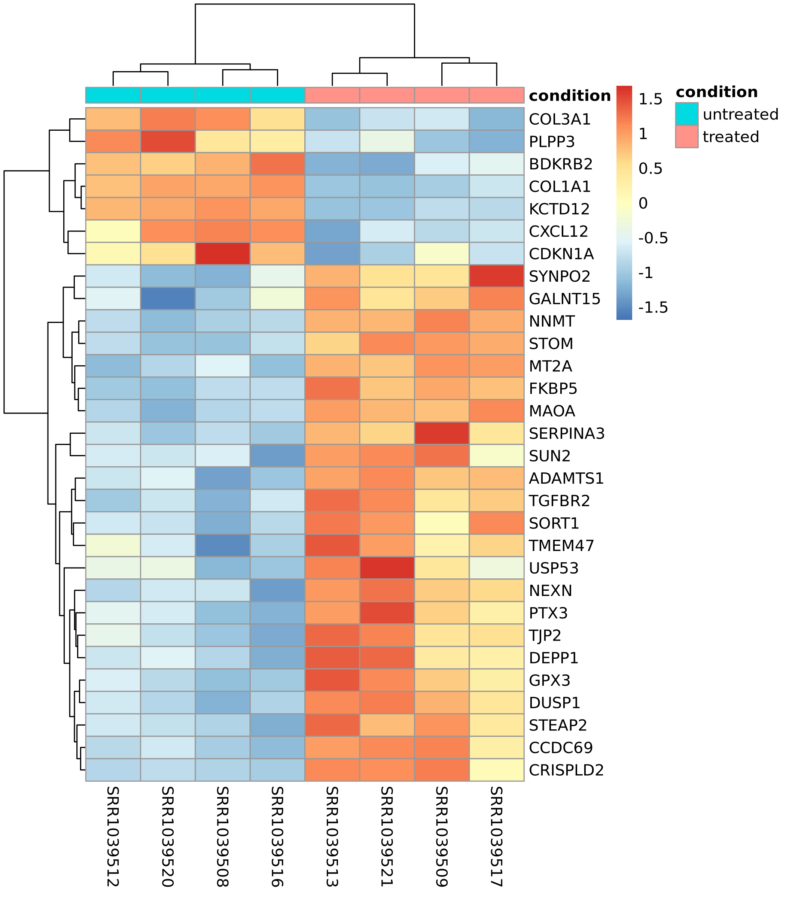
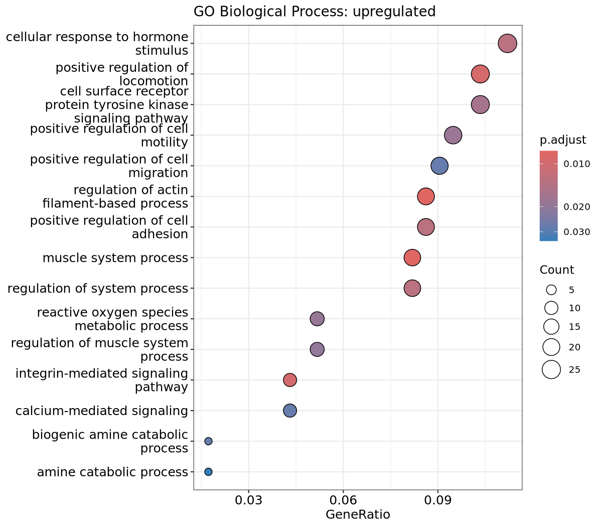
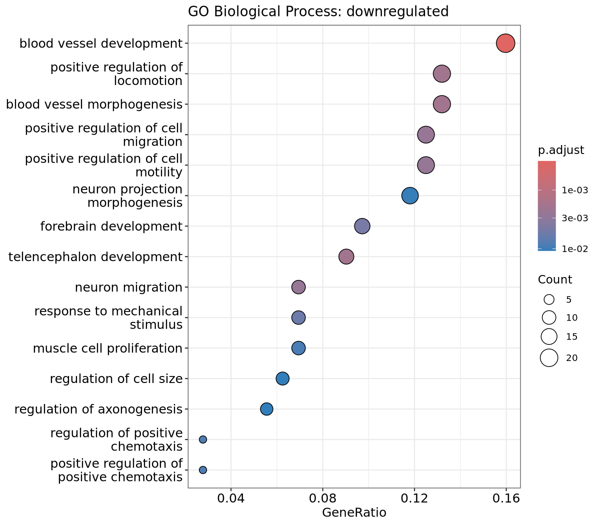

   Rscript scripts/08_go_enrichment.R# Airway RNA-seq Differential Expression Pipeline

A reproducible RNA-seq workflow that finds genes responding to dexamethasone
(a glucocorticoid steroid) in human airway smooth muscle cells, from raw
reads to figures.

## Biological question
Which genes change expression after dexamethasone treatment compared with
untreated cells?

## Dataset
- GEO: GSE52778, SRA project: SRP033351
- 8 samples: 4 cell lines, each untreated and treated (paired design)
- Reads were **subsampled to the first 1 million read pairs per sample**
  so the whole pipeline runs on a laptop

## Pipeline


## Tools
FastQC, MultiQC, fastp, Salmon, R, tximport, DESeq2, clusterProfiler, ggplot2, pheatmap,
org.Hs.eg.db. The full environment is in `environment.yml`.

## How to run
```bash
mamba env create -f environment.yml
conda activate rnaseq
printf "SRR1039508\nSRR1039509\nSRR1039512\nSRR1039513\nSRR1039516\nSRR1039517\nSRR1039520\nSRR1039521\n" > data/samples.txt
bash scripts/01_download.sh
bash scripts/02_qc.sh
bash scripts/03_trim.sh
# download the Ensembl GRCh38 cDNA FASTA into data/ref/, then:
bash scripts/04_make_tx2gene.sh
bash scripts/05_salmon_index.sh
bash scripts/06_quant.sh
Rscript scripts/07_deseq2.R
Rscript scripts/08_go_enrichment.R
```

## Results
- Salmon mapping rate: **94.1% to 95.3%** across the 8 samples
- Genes tested (after filtering low counts): **13,562**
- Significant genes (padj < 0.05, |log2FC| > 1): **401**
  (**247 up**, **154 down** after treatment)





Full results table: `results/deseq2_results.csv`

Top genes by adjusted p-value:

| Gene | log2FC | padj |
|------|--------|------|
| GPX3 | 3.64 | 2.5e-86 |
| COL1A1 | -1.37 | 2.0e-76 |
| CXCL12 | -1.92 | 1.8e-62 |
| ADAMTS1 | 2.37 | 7.3e-59 |
| COL3A1 | -1.36 | 6.6e-53 |
| NNMT | 2.18 | 7.0e-44 |
| PTX3 | 2.29 | 2.2e-41 |
| SORT1 | 2.04 | 1.0e-40 |
| SYNPO2 | 1.53 | 3.3e-35 |
| SERPINA3 | 3.04 | 8.8e-34 |

### GO enrichment (Biological Process)
Genes were split into up-regulated (log2FC > 1) and down-regulated
(log2FC < -1) sets at padj < 0.05 and tested against all 13,562 tested genes
as the background (clusterProfiler, Benjamini-Hochberg correction).




- **Up-regulated genes (31 enriched terms):** include cellular response to
  hormone stimulus, muscle system process, regulation of actin
  filament-based process, integrin-mediated signaling and positive
  regulation of locomotion. The hormone-response term fits the glucocorticoid
  treatment, and the others point to changes in the contractile and adhesion
  machinery of smooth muscle cells.
- **Down-regulated genes (134 enriched terms):** dominated by blood vessel
  development and morphogenesis, cell migration and motility, and response
  to mechanical stimulus. This matches the strong down-regulation of
  extracellular-matrix and signalling genes such as COL1A1, COL3A1 and CXCL12.
- Cell motility terms appear in both sets, driven by different genes.
- Terms such as telencephalon and forebrain development most likely reflect
  shared developmental signalling genes and not brain-specific activity.

## Interpretation
- **Pipeline validation:** Four well-known glucocorticoid-responsive genes
  were all strongly up-regulated: KLF15 (log2FC 5.69, padj 7.9e-11),
  TSC22D3 (3.18, padj 2.6e-17), DUSP1 (2.94, padj 1.8e-26) and PER1
  (2.76, padj 2.2e-04). This matches the published airway analysis and
  shows the pipeline works.
- **Overall response:** Dexamethasone changed the expression of hundreds
  of genes, with more genes up-regulated (247) than down-regulated (154).
- **Down-regulated genes:** Several of the strongest down-regulated genes
  are extracellular matrix and signalling genes (COL1A1, COL3A1, CXCL12).
- **PCA:** [Edit this line to match your plot: describe whether treated and
  untreated samples separate and whether the cell lines spread along the
  other axis.]

## Limitations
- Reads were subsampled, so counts and the number of significant genes
  differ from a full-depth analysis
- Only 4 biological replicates per condition
- Gene-level analysis only, with no isoform-level analysis
- GO analysis covers Biological Process only, and the terms are partly redundant

## Author
Zainab, M.Sc. Bioinformatics, Jamia Millia Islamia# airway-rnaseq-pipeline
RNA-seq differential expression pipeline: FastQC, fastp, Salmon, DESeq2
